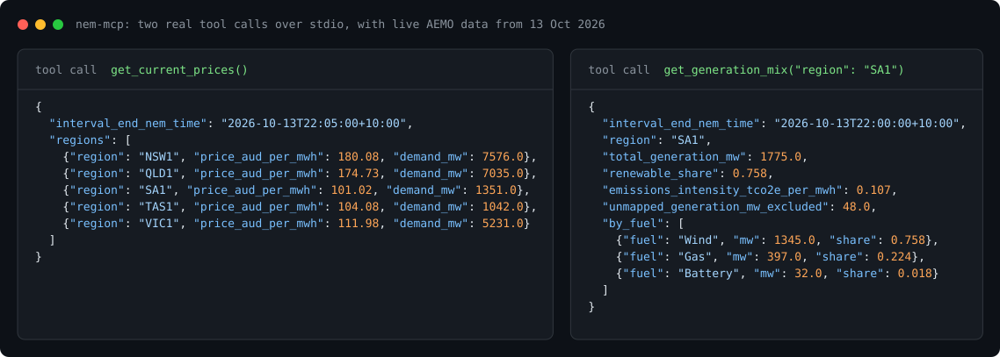

# nem-mcp

An MCP server that gives an AI assistant live data from Australia's National Electricity Market (NEM).

[](https://github.com/Guinerve/nem-mcp/actions/workflows/ci.yml)
[](LICENSE)



*Two real calls over stdio on 13 October 2026, about 22:00 NEM time. The raw replies are in [`assets/demo.json`](assets/demo.json).*

I built this so I can ask Claude about the grid and get answers from AEMO's own data. For example: "What is the price in South Australia now, and why is it so low?" AEMO publishes a new dispatch file every 5 minutes on [NEMWeb](https://nemweb.com.au/Reports/Current/). The files are free, but they are zipped CSV in AEMO's MMS format, so an assistant cannot read them directly. This server fetches and parses them and gives back plain JSON. Each field name carries its unit, for example `price_aud_per_mwh` or `demand_mw`.

The repo also holds `nem`, a small Python client for the same data. My projects [carbon-aware-au](https://github.com/Guinerve/carbon-aware-au) and [nem-pulse](https://github.com/Guinerve/nem-pulse) install it from here.

## Quick start

You need [uv](https://docs.astral.sh/uv/). You do not need an API key.

**Claude Code.** Run this one command:

```bash
claude mcp add nem -- uvx --from git+https://github.com/Guinerve/nem-mcp nem-mcp
```

**Claude Desktop.** Add this to `claude_desktop_config.json`, then restart Claude Desktop:

```json
{
  "mcpServers": {
    "nem": {
      "command": "uvx",
      "args": ["--from", "git+https://github.com/Guinerve/nem-mcp", "nem-mcp"]
    }
  }
}
```

Other MCP clients use the same command: `uvx --from git+https://github.com/Guinerve/nem-mcp nem-mcp`. The server talks over stdio.

Then ask a question, for example:

- "What are the NEM prices right now?"
- "How much of South Australia's power is wind at the moment?"
- "Is power flowing from Victoria into New South Wales?"
- "Were there any negative prices in SA1 in the last 2 hours?"

## Tools

| Tool | Arguments | What it returns |
|------|-----------|-----------------|
| `get_current_prices` | none | Regional reference price ($/MWh) and total demand (MW) for the latest 5 minute interval, for all five regions |
| `get_generation_mix` | `region` (optional) | MW and share by fuel, renewable share, and average emissions intensity (t CO2e/MWh), for one region or the whole NEM |
| `get_interconnector_flows` | none | Flow, losses, and export and import limits (MW) on each interconnector |
| `get_recent_price_spikes` | `region`, `hours` (up to 4), `above_aud_per_mwh` (default 300), `below_aud_per_mwh` (default 0) | Intervals where the price went above or below the limits you set |

Regions are `NSW1`, `QLD1`, `VIC1`, `SA1` and `TAS1`. The tools also accept `NSW`, `sa` and so on. All times are NEM time (AEST, UTC+10, with no daylight saving).

## How it works

1. The server finds the newest files in three NEMWeb folders. `DispatchIS_Reports` has prices, demand and interconnector flows. `Dispatch_SCADA` has the output of each unit. `CDEII` has AEMO's register of units, with the fuel and emissions factor of each.
2. It downloads the zip, then reads the MMS CSV inside. Each `I` row declares a table and each `D` row is data for that table.
3. For prices it uses AEMO's pricing run. When AEMO intervenes in the market, interconnector flows come from the intervention run, because that run sets what really happens.
4. For the generation mix it joins unit output to the register and adds up the MW by fuel. Emissions are MW multiplied by each unit's emissions factor.
5. Dispatch files never change after AEMO publishes them, so the client caches them in `~/.cache/nem`. A 4 hour price scan downloads each file once. The unit register changes rarely, so the client keeps a copy for 6 hours.

The `nem` package also reads AEMO's daily archive (`nem.archive`). nem-pulse uses it for daily summaries, and carbon-aware-au uses it for validation.

## How I know it is right

- **Recorded data.** The tests use real AEMO files from 12 October 2026: one DispatchIS file, one SCADA file and the unit register (`tests/fixtures/`). They load them through `httpx.MockTransport`, so the tests never touch the live feed.
- **Flow direction.** A positive flow runs from the first region in the name to the second. I checked this against AEMO's region pair table in the same file. `NSW1-QLD1` plus `N-Q-MNSP1` gives -926.03 MW, which is AEMO's total for NSW1 to QLD1. `V-SA` plus `V-S-MNSP1` gives +348.10 MW, which is AEMO's total for VIC1 to SA1. A test checks both sums.
- **Emissions intensity.** carbon-aware-au uses this client to compute daily intensity. Against AEMO's published CDEII figures for 21 to 27 September 2026 (35 region days), the mean absolute error was 2.8 %.
- **Live run.** The image at the top comes from a live run. SA1 was 76 % wind at $101.02/MWh. NSW1 was $180.08/MWh. I have not yet checked a live interval line by line against AEMO's dashboard.

## Limits

- **No rooftop solar.** The mix covers only units that send 5 minute SCADA data to AEMO. In daytime this understates solar, mostly in NSW, QLD and SA.
- **Unmapped units.** Some units are not in AEMO's CDEII register. On 13 October 2026 these were two Kareeya hydro units and the Tully sugar mill, about 48 MW in total. The mix leaves them out and reports their output as `unmapped_generation_mw_excluded`. These units have no region, so this number is always for the whole NEM.
- **Batteries.** A battery counts as generation only when its output is positive. Charging is left out.
- **Average intensity.** Emissions intensity is the average of local generation. It is not the marginal intensity, and it ignores imports from other regions.
- **Recent data only.** The live tools read NEMWeb's "current" folder, so the price scan goes back 4 hours at most.
- **No forecasts.** The server reports published data only. It does not forecast and it does not give trading advice.
- **Errors.** If NEMWeb sends an empty listing, a bad zip or a file without the expected tables, the client raises `NemDataError`. The daily archive loader does the same for a bad zip. HTTP errors come through as `httpx` errors. If a region has no generation, intensity is `null`.
- **Cache size.** The client never cleans the cache in `~/.cache/nem`. If a client calls the tools all day, the cache grows by about 7 MB per day.

## Use the `nem` client in Python

```python
from nem import NemClient, generation_mix, emissions_intensity, renewable_share

client = NemClient()
snap = client.dispatch_snapshots(1)[0]
print(snap.interval_end, snap.prices)

mix = generation_mix(client.generation_by_unit(), "SA1")
print(f"{renewable_share(mix):.0%} renewable, {emissions_intensity(mix):.3f} t CO2e/MWh")
```

To use it in another project, add it as a git dependency:

```bash
uv add git+https://github.com/Guinerve/nem-mcp
```

## Development

```bash
git clone https://github.com/Guinerve/nem-mcp
cd nem-mcp
uv sync
uv run pytest -q          # 26 tests, no network
uv run ruff check .
uv run nem-mcp            # start the server on stdio
```

To draw the image at the top again from live data, run `uv run python scripts/render_demo.py`. It needs network access to NEMWeb.

## Roadmap

- Add rooftop solar from AEMO's `ROOFTOP_PV/ACTUAL` report.
- Add a tool that explains a price spike from the binding constraints in `DISPATCH.CONSTRAINT`.
- Check one live interval line by line against AEMO's dashboard.

## Licence

MIT. See [LICENSE](LICENSE). The data comes from AEMO's NEMWeb, and AEMO's copyright terms apply to it.
